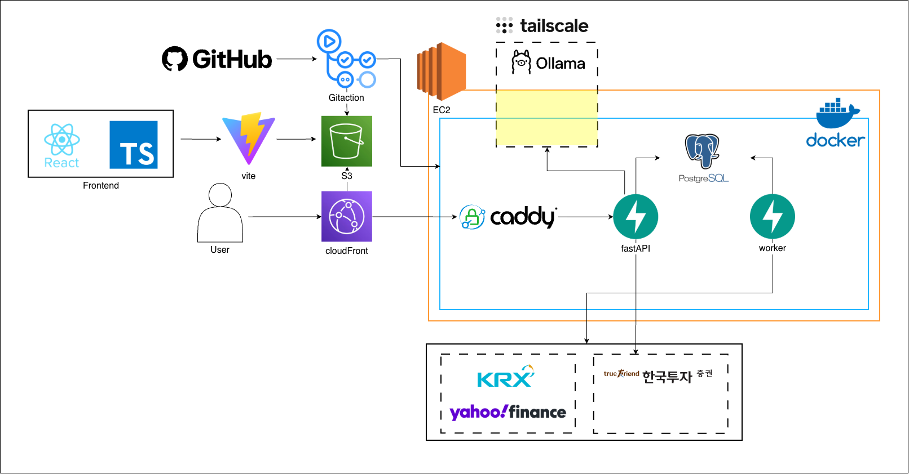
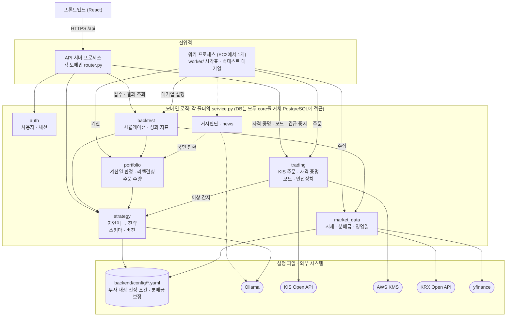
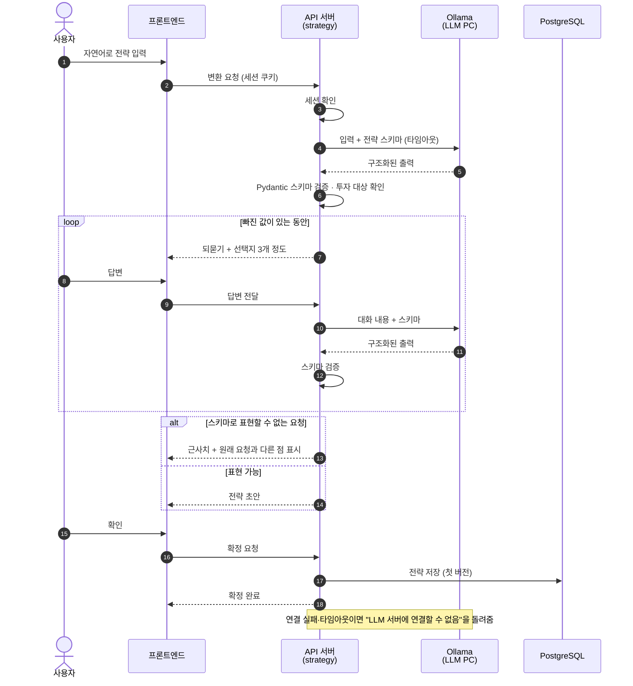
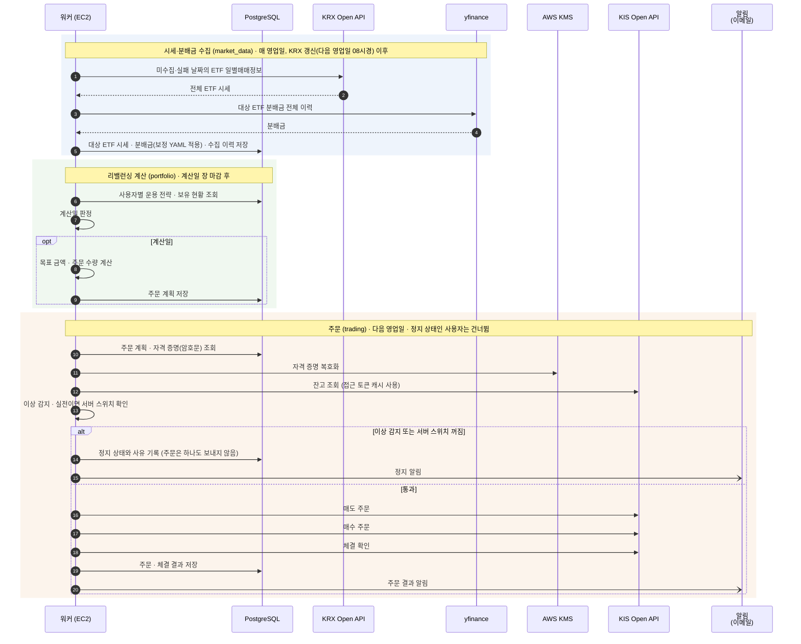

# 시스템 아키텍처

시스템을 이루는 프로세스와 외부 시스템, 그 사이의 호출 관계, 작업 실행 방식을 정의합니다.
기기 배치와 네트워크(Tailscale, 포트, HTTPS)는 `docs/infra.md`, 각 도메인의 로직은 `docs/<도메인>.md`를 따릅니다.

## 구성 요소

편집 방법과 로고 출처는 아래 "다이어그램" 섹션에 있습니다.

| 구성 요소 | 역할 | 실행 위치 |
|---|---|---|
| CloudFront | HTTPS 종료(서비스 도메인), `/api/*`는 EC2로, 나머지는 S3로 전달 | AWS |
| S3 | 프론트엔드 빌드 결과(정적 파일) 저장 | AWS |
| 리버스 프록시 (Caddy) | CloudFront에서 온 `/api` 요청의 HTTPS 종료(오리진용 하위 도메인 인증서), API 서버로 전달 | EC2 (Docker) |
| API 서버 | 사용자 요청 처리. 인증, 전략 변환·확정, 백테스트 요청 접수와 결과 조회, 자격 증명 등록, 모드 전환, 긴급 중지 | EC2 (Docker). 개발 때는 팀원 PC |
| 워커 | 예약 작업과 백테스트 대기열 처리 | **EC2에서만** (Docker) |
| PostgreSQL | 모든 상태 저장. API 서버와 워커는 DB로만 주고받습니다 | EC2 (Docker) |
| Ollama | 자연어 → 전략 변환, 국면 지표용 뉴스 분위기 점수·금통위 결정문 판정 | LLM PC |

- EC2의 리버스 프록시, API 서버, 워커, PostgreSQL은 Docker Compose(`deploy/compose.yaml`)로 한 번에 띄웁니다. 배포는 GitHub Actions가 합니다(`docs/infra.md`).
- API 서버와 워커는 같은 코드베이스(`backend/app/`)를 씁니다. 워커는 각 도메인의 `service.py` 함수를 부르기만 하고, 도메인 로직을 따로 갖지 않습니다.
- API 서버와 워커는 서로 직접 호출하지 않습니다. 백테스트 요청, 정지 상태, 주문 결과 등은 모두 DB를 거칩니다.

## 워커

### EC2에서만 실행하는 이유

팀원 PC의 API 서버도 서비스 DB에 붙습니다. 예약 작업을 API 서버 안에서 돌리면 팀원이 개발 서버를 켤 때마다 수집과 주문이 그 PC에서도 실행됩니다. 그러면 수집 이력이 꼬이고 호출 한도가 낭비되며, 같은 주문이 여러 번 나갈 수 있습니다. 그래서 예약 작업은 별도 워커 프로세스로 분리하고, 워커는 EC2에서 하나만 실행합니다.

- API 서버는 예약 작업을 실행하지 않습니다.
- 진입점은 `backend/app/worker/`에 둡니다. 시각표와 대기열 처리만 두고 도메인 로직은 두지 않습니다.
- 시각은 한국 시간(KST) 기준입니다. EC2의 시스템 시간대와 관계없이 동작해야 합니다.

### 예약 작업

| 작업 | 시점 | 호출하는 로직 |
|---|---|---|
| 시세·분배금·국면 지표 수집 | 매 영업일. KRX 데이터가 갱신된 뒤 | `market_data` |
| 계산일 판정·리밸런싱 계산 | 계산일 장 마감 후 | `portfolio` |
| 주문, 체결 확인 | 계산일 다음 영업일 | `trading` |
| 분배금 입금 확인, 재투자 | `docs/trading.md` 주문 방식을 따름 | `trading`, `portfolio` |
| 국면 판단(거시판단) | 매주 마지막 영업일 장 마감 후 | 거시판단(`docs/macro.md`). 국면이 바뀌면 `portfolio`가 그날을 계산일로 전체 리밸런싱을 계산 |

- KRX ETF 일별매매정보는 **다음 영업일 오전 8시경**에 갱신된다고 알려져 있습니다. 공식 문서에서는 확인하지 못했고, 비공식 라이브러리 문서들이 같은 시각을 적고 있습니다.
- 그래서 계산일 장 마감 직후에는 그날 종가가 KRX 데이터에 아직 없습니다. 모의·실전투자의 계산일 종가 출처와 주문 시각은 `docs/trading.md`를 봅니다.

### 백테스트 대기열

백테스트는 전략 하나를 세 가지 방식(고정비중 운용, 거시판단 운용, LLM 지표를 뺀 거시판단 운용)으로 수천 영업일에 걸쳐 계산하므로 요청 안에서 끝내지 않습니다(`docs/backtest.md`).

1. API 서버가 요청을 DB의 백테스트 작업 테이블에 넣고 작업 ID를 바로 돌려줍니다.
2. 워커가 대기 중인 작업을 가져와 실행하고, 결과를 DB에 저장합니다.
3. 프론트엔드는 작업 ID로 상태(대기, 실행 중, 완료, 실패)와 결과를 조회합니다.

- 결과는 DB에 남으므로 브라우저를 닫아도 잃지 않습니다.

## 요청 처리 방식

| 요청 | 방식 | 이유 |
|---|---|---|
| 자연어 → 전략 변환 | 동기 요청 + 타임아웃 | 빠진 값을 되묻는 대화형이라 사용자가 응답을 기다립니다 |
| 백테스트 | 대기열 + 상태 조회 | 계산이 길고 결과를 저장해야 합니다 |
| 그 밖의 조회·등록 | 동기 요청 | — |

- LLM 서버에 연결할 수 없거나 타임아웃이 나면 원인이 드러나는 오류를 돌려줍니다(`docs/infra.md`).

## 다이어그램

실선은 확정된 내용, 점선은 아직 정하지 않은 내용입니다. 정하지 않은 내용의 상세는 각 기준 문서의 "미정"에 있습니다. 설계가 바뀌면 다이어그램도 함께 고칩니다.

### 시스템 구성도

그림은 위 "구성 요소" 섹션에 있습니다.

- 파일은 `docs/diagrams/system.drawio.svg`입니다. GitHub에서는 그림으로 보이고, draw.io에서 열면 그대로 편집할 수 있습니다.
- 편집: [app.diagrams.net](https://app.diagrams.net)(브라우저), VS Code의 Draw.io Integration 확장, 또는 draw.io 데스크톱 앱에서 엽니다. 저장할 때 형식을 `.drawio.svg`로 유지합니다.
- 로고는 파일 안에 포함되어 있습니다. 출처: 각 사의 공식 사이트(한국투자증권, KRX, Yahoo Finance, Ollama), Simple Icons(Tailscale), draw.io 내장 아이콘(AWS KMS·CloudFront·S3, GitHub), 팀 로고 모음(FastAPI, PostgreSQL, React, AWS EC2, Docker). 로고의 상표권은 각 사에 있습니다.

### 컴포넌트 관계도

`backend/app/`의 폴더가 서로 무엇을 부르는지 보여 줍니다. 화살표는 "부른다(의존한다)"는 뜻입니다.

### 시퀀스: 자연어 → 전략 변환

### 시퀀스: 일일 자동 운용 (워커)

## 미정

- 워커의 스케줄 라이브러리, 백테스트 작업을 동시에 몇 개까지 돌릴지
- 팀원 PC에서 테스트 DB를 대상으로 워커를 시험 실행하는 것을 허용할지, 서비스 DB에 붙은 워커가 EC2 밖에서 실행되지 않도록 막는 장치
- LLM 호출 타임아웃 값 (CloudFront 오리진 응답 타임아웃 30초보다 짧아야 합니다, `docs/infra.md`)
- 긴급 중지·실전→모의 전환 때 미체결 주문 취소를 API 서버가 바로 할지, 워커에 맡길지
- ERD: 테이블 구조(전략 Pydantic 모델 #10, 각 도메인 `models.py`)가 정해진 뒤 그립니다
